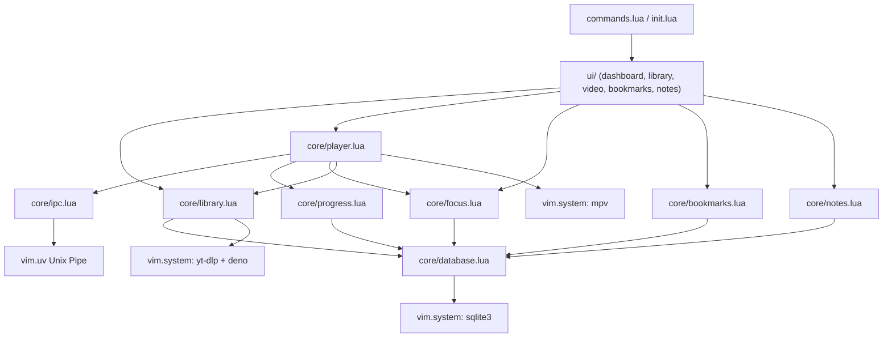
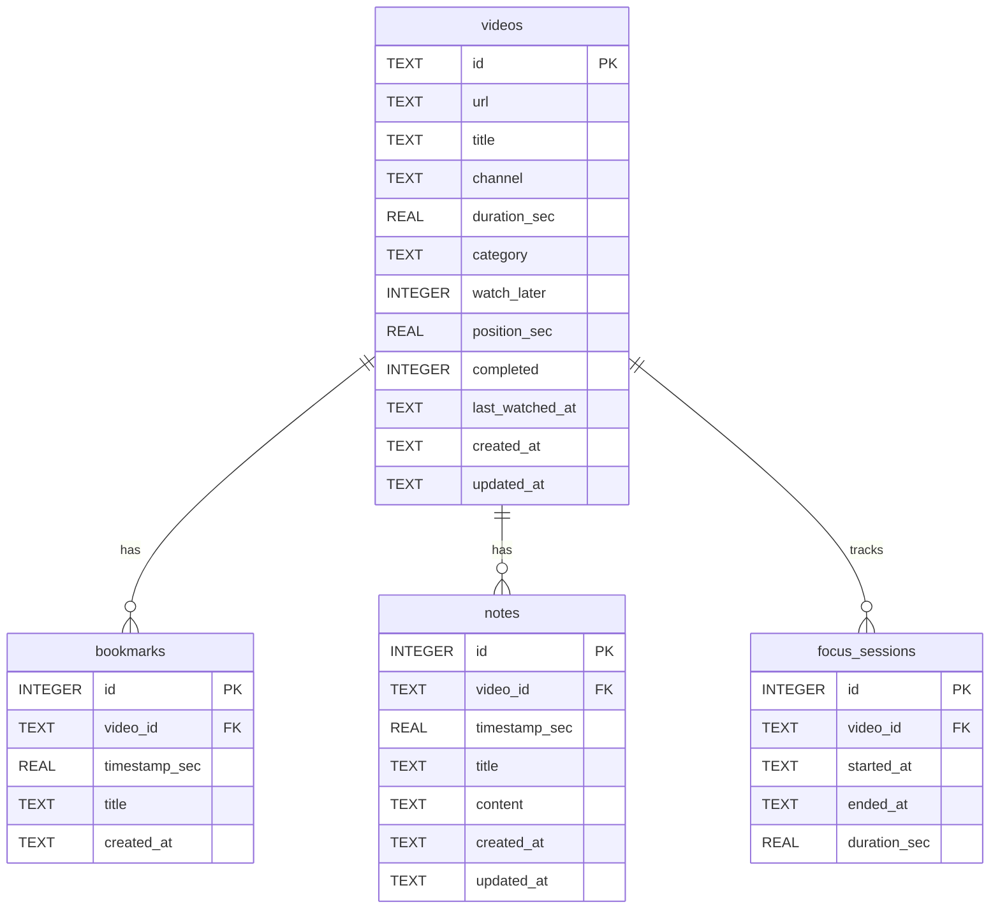
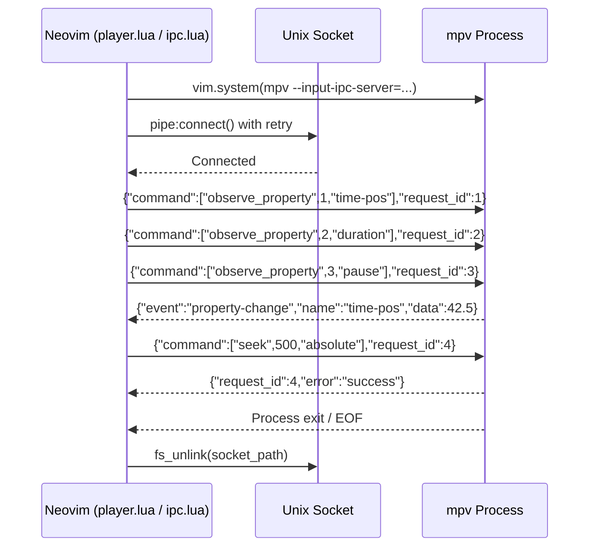
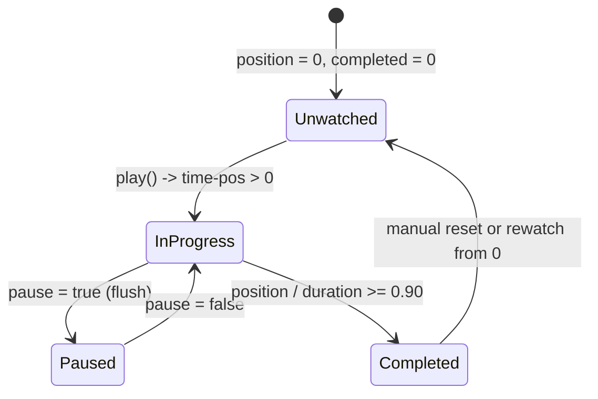
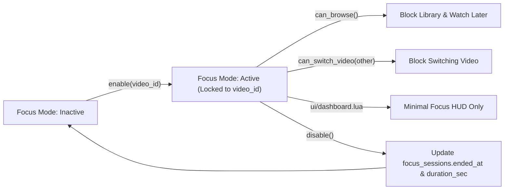

# FocusTube.nvim: Architecture and Systems Design of an Intentional Video Learning Environment in Neovim

## 1. Problem Statement and Design Philosophy

Standard web-based video platforms are optimized for session duration rather than structured comprehension. Algorithmic recommendation sidebars, autoplay queues, and short-form feeds introduce continuous context switching that disrupts sustained attention, particularly for learners with Attention-Deficit/Hyperactivity Disorder (ADHD).

FocusTube.nvim addresses this problem by decoupling video selection from video playback and embedding the entire learning workflow inside Neovim. Instead of rendering a browser interface, FocusTube treats a curated YouTube URL as an immutable local study unit. Metadata is extracted once, stored locally, and played in an external `mpv` window controlled exclusively through a local Unix domain socket.

The architecture follows five engineering constraints:

1. **Zero Browser Surface**: No embedded web views, no recommendation feeds, and no short-form URLs.
2. **Local-First State**: All library records, playback positions, timestamps, notes, and focus sessions reside in a local SQLite database.
3. **Explicit Approval**: The player module refuses to launch any video identifier not already registered in the local library.
4. **Crash Resilience**: Playback progress is persisted periodically, on state transitions, and on editor exit.
5. **Minimalist Interface**: Floating Neovim buffers expose only the controls required for the active task.

---

## 2. System Architecture and Module Boundaries

FocusTube.nvim is organized into four strict layers inside `lua/focustube/`:

1. **Entry and Command Layer** (`init.lua`, `config.lua`, `commands.lua`, `plugin/focustube.lua`): Handles lazy initialization, user configuration merging, user commands, keymaps, and `VimLeavePre` lifecycle hooks.
2. **Core Domain Layer** (`core/`): Encapsulates persistence (`database.lua`), curation (`library.lua`), IPC (`ipc.lua`), process management (`player.lua`), progress tracking (`progress.lua`), bookmarks (`bookmarks.lua`), notes (`notes.lua`), and session locking (`focus.lua`).
3. **Presentation Layer** (`ui/`): Renders floating Neovim windows for the dashboard, library, single-video workspace, bookmarks, and Markdown note editor.
4. **Utility Layer** (`utils/`): Provides pure helpers for time formatting (`time.lua`), safe JSON decoding (`json.lua`), XDG paths (`paths.lua`), and subprocess execution (`system.lua`).



This separation ensures that UI modules contain no SQL or process-spawning logic, and core modules remain testable in headless Neovim without opening windows.

---

## 3. URL Validation and Metadata Extraction

Before any external network request occurs, `utils/system.lua` validates the user-supplied URL through `parse_youtube_url(url)`. The validator enforces three rules:

- The scheme and host must match `youtube.com`, `youtu.be`, or `youtube-nocookie.com`.
- URLs matching `youtube.com/shorts/` are rejected immediately.
- A valid video identifier must be extractable from `?v=`, `&v=`, `youtu.be/`, `/live/`, or `/embed/`.

Once validated, the URL is normalized to `https://www.youtube.com/watch?v=<id>`.

Metadata retrieval in `core/library.lua` runs asynchronously via `vim.system` so the Neovim UI thread never blocks:

```
yt-dlp --dump-json --no-playlist --no-warnings --skip-download --js-runtimes deno <canonical_url>
```

Passing `--js-runtimes deno` ensures `yt-dlp` resolves YouTube extraction challenges using the local Deno runtime without requiring Node.js or Python scripts. When `yt-dlp` exits, `library.add_url` parses the first JSON line and stores `id`, `url`, `title`, `channel`, and `duration_sec` in SQLite.

---

## 4. Local Persistence and Schema Design

All persistent state is stored in `<stdpath("data")>/focustube/focustube.db` via `core/database.lua`. To avoid compiled C-extension dependencies or ABI mismatches across LuaJIT builds, `database.lua` invokes the `sqlite3` binary with `-batch -json` for queries and `-batch` for mutations.

Every invocation configures three SQLite safeguards:

- `PRAGMA journal_mode=WAL`: Allows concurrent reads while writes flush without blocking.
- `.timeout 5000`: Prevents transient lock errors during rapid progress updates.
- `PRAGMA foreign_keys=ON`: Enforces referential integrity across tables.

### Relational Schema



### Parameter Binding

Because SQL statements are passed to `sqlite3`, `database.bind(sql, params)` replaces positional `?` placeholders using `database.quote(val)`:

- `nil` / `vim.NIL` becomes `NULL`.
- Booleans become `1` or `0`.
- Finite numbers serialize directly; `NaN` and infinities become `NULL`.
- Strings escape single quotes (`'` to `''`) and wrap in single quotes.

This guarantees that video titles or Markdown notes containing quotes, semicolons, or SQL keywords cannot alter query structure.

---

## 5. External Playback and Unix Domain Socket IPC

`core/player.lua` coordinates `mpv` process lifecycle and `core/ipc.lua` manages bidirectional JSON communication.

### Socket Isolation

FocusTube never binds TCP ports or network sockets. For each playback session, `utils/paths.lua` generates a unique local socket path under `$XDG_RUNTIME_DIR/focustube/` (falling back to `<stdpath("state")>/focustube/`):

```
mpv-<pid>-<hrtime>.sock
```

`player.play(video_id)` verifies that `focus.can_switch_video(video_id)` is true and `library.is_approved(video_id)` is true. It then spawns `mpv` via `vim.system` using an explicit argument array (no shell interpolation):

- `--input-ipc-server=<socket_path>`
- `--start=<resume_position>` (if `resume_position > 0`)
- `--ytdl-raw-options=js-runtimes=deno` (if `deno` is available)
- `<video.url>`

### Connection and Framing Protocol

Because `mpv` creates its IPC socket asynchronously after process startup, `ipc.Client:connect` uses a retry loop (`ipc_connect_retries = 25`, `ipc_retry_interval_ms = 100`) backed by `vim.uv.new_pipe(false)` and `vim.uv.new_timer()`.

Once connected, messages follow mpv's newline-delimited JSON protocol:



Incoming chunks from `pipe:read_start` are accumulated in a line buffer, split on `\n`, decoded safely via `pcall(vim.json.decode, line)`, and routed either to a pending `request_id` callback or to the `on_event` handler. On process exit or `stop()`, `player._cleanup()` closes the pipe, stops progress timers, and unlinks the temporary socket file.

---

## 6. Crash-Resilient Progress Tracking and Completion Semantics

`core/progress.lua` maintains playback continuity across normal exits, pauses, and unexpected crashes.

### Flush Triggers

Progress is written to the `videos` table under four conditions:

1. **Periodic Timer**: A `vim.uv` timer fires every `save_interval_ms` (default 5000 ms) and flushes if `dirty` is true.
2. **Pause Event**: When `mpv` emits `property-change` with `name = "pause"` and `data = true`, progress flushes immediately.
3. **End of Playback**: When `eof-reached` or `end-file` arrives, or when `mpv` exits, `stop_tracking()` flushes final coordinates before tearing down state.
4. **Neovim Exit**: An autocmd on `VimLeavePre` stops any active player and flushes state before Neovim closes.

### Completion and Resume Calculation

When saving `position_sec` against a positive `duration_sec`, `should_mark_completed` checks:

```
position_sec / duration_sec >= completion_threshold (default 0.90)
```

Once a video reaches `completed = 1`, subsequent saves preserve the completed flag via SQLite `CASE WHEN completed = 1 THEN 1 ELSE ? END`.

When resuming a video, `get_resume_position(video)` returns `0` if the video is already completed or if `position_sec >= duration_sec - resume_margin_sec` (default 5 seconds). Otherwise, playback resumes at `position_sec`.



---

## 7. Timestamp Bookmarks and Temporal Indexing

`core/bookmarks.lua` enables instant capture and navigation of key moments within a video.

When the user triggers a bookmark (`b` in the Video Workspace, `a` in the Bookmarks window, or `:FocusTubeBookmark`), FocusTube reads `player.get_state().position_sec` for the active video (falling back to the stored `video.position_sec` when stopped). The bookmark is inserted into `bookmarks` and indexed by `(video_id, timestamp_sec)`.

Queries return bookmarks sorted chronologically (`ORDER BY timestamp_sec ASC, id ASC`), formatted by `utils/time.lua` as:

```
08:20 — Mason configuration
12:34 — Treesitter setup
```

Selecting a bookmark in `ui/bookmarks.lua` checks whether `mpv` is currently playing that video:

- If active: sends `{ "seek", timestamp_sec, "absolute" }` over IPC and updates local progress immediately.
- If inactive: launches `mpv` with `start_sec = timestamp_sec`.

---

## 8. Markdown Learning Notes and Buffer Persistence

`core/notes.lua` and `ui/notes.lua` pair structured timestamped notes with native Neovim editing.

Each note belongs to a `video_id`, carries a required `title`, an optional `timestamp_sec`, and a Markdown `content` body. Notes sort with timestamped entries first in ascending order, followed by general (non-timestamped) notes.

Rather than building a custom text input widget, `ui/notes.open_editor` creates a scratch Neovim buffer configured with:

- `buftype = "acwrite"`
- `filetype = "markdown"`
- A virtual buffer name (`focustube://note/<id>/<title>.md`)

A buffer-local `BufWriteCmd` autocmd intercepts `:w` (and `<C-s>`), reads all buffer lines, updates the `notes` table in SQLite, and clears `vim.bo[buf].modified`. Pressing `q` auto-saves if modified and closes the floating window. Users can also export all notes for a video into a consolidated Markdown buffer via `notes.to_markdown(video)`.

---

## 9. Focus Mode State Machine and Behavioral Enforcement

Focus Mode (`core/focus.lua`) is the behavioral core of FocusTube.nvim. Its objective is to eliminate mid-session browsing once a learner commits to a single video.

When `focus.enable(video_id)` is called:

1. It verifies the video exists in the approved library.
2. It inserts a new row in `focus_sessions` with `started_at`.
3. It sets internal state `active = true` and locks `video_id`.

While `focus.is_active()` is true, two enforcement guards activate across the plugin:

- **`focus.can_browse()`**: Returns `false` when `config.focus.block_browsing` is enabled. Both `ui/library.lua` and `ui/dashboard.lua` refuse to open the library or Watch Later queues, redirecting the user to the locked Video Workspace instead.
- **`focus.can_switch_video(target_id)`**: Returns `true` only if `target_id == locked_video_id`. `player.play()` checks this guard before spawning `mpv`, preventing accidental playback of another video.



In `ui/dashboard.lua`, Focus Mode hides library statistics, Watch Later counts, and URL addition shortcuts, displaying only the active video title, progress bar, session timer, and direct playback/note/bookmark actions.

---

## 10. Verification, Testing Strategy, and Deployment

FocusTube.nvim ships with an isolated headless test suite at `tests/run.lua`, executable directly with Neovim:

```bash
nvim --headless -u NONE -l tests/run.lua
```

The test harness creates a temporary SQLite database per run and verifies:

1. Time formatting, timestamp parsing (`SS`, `MM:SS`, `HH:MM:SS`), and progress bar rendering.
2. YouTube URL validation, ID extraction, and Shorts/non-YouTube rejection.
3. SQLite library CRUD, category filtering, Watch Later toggles, and SQL single-quote escaping.
4. Progress persistence, 90% completion threshold logic, and resume position clamping.
5. Bookmark chronological ordering, renaming, and deletion.
6. Note creation, updates, deletion, and Markdown export structure.
7. Focus Mode browsing locks, video-switching blocks, and session recording.
8. Live Unix domain socket IPC roundtrip using an in-process `vim.uv.new_pipe(false)` server to verify JSON command/response correlation and asynchronous `property-change` event delivery.
9. User command registration (`:FocusTube`, `:FocusTubeLibrary`, `:FocusTubeAdd`, `:FocusTubeFocus`, `:FocusTubeHealth`).

For deployment, `plugin/focustube.lua` registers `:FocusTube` lazily, and `lazy.nvim` loads the plugin from a local directory or GitHub repository with `:FocusTubeHealth` confirming availability of `mpv`, `yt-dlp`, `deno`, and `sqlite3`.
