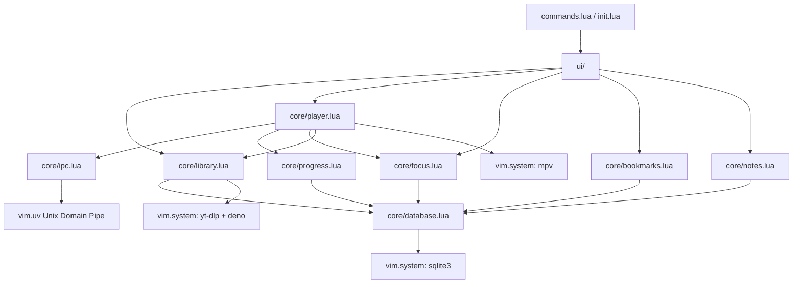

# Page 02: Layered Architecture and Module Boundaries

## 2.1 Four-Layer Separation

FocusTube.nvim isolates responsibilities across four directories under `lua/focustube/` so that UI rendering, domain state, and subprocess I/O never leak into one another:

1. **Entry and Command Layer** (`init.lua`, `config.lua`, `commands.lua`, `plugin/focustube.lua`): Registers `:FocusTube*` commands, merges user options, initializes the database, and attaches the `VimLeavePre` shutdown hook.
2. **Core Domain Layer** (`core/`): Owns business logic and state (`database.lua`, `library.lua`, `ipc.lua`, `player.lua`, `progress.lua`, `bookmarks.lua`, `notes.lua`, `focus.lua`).
3. **Presentation Layer** (`ui/`): Renders floating Neovim buffers (`dashboard.lua`, `library.lua`, `video.lua`, `bookmarks.lua`, `notes.lua`).
4. **Utility Layer** (`utils/`): Pure helpers for time formatting (`time.lua`), JSON parsing (`json.lua`), XDG paths (`paths.lua`), and process wrappers (`system.lua`).

## 2.2 Dependency Graph

## 2.3 Design Consequence

Because `core/` modules depend only on `config.lua`, `utils/`, and `vim.uv`/`vim.system`, the entire domain layer executes deterministically in headless Neovim (`nvim --headless`) without creating UI windows.

---
[Previous: Page 01](./01-problem-and-philosophy.md) | [Index](./README.md) | [Next: Page 03](./03-url-validation-and-ytdlp.md)
