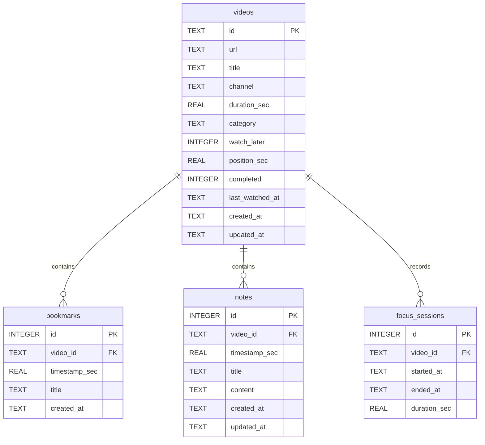

# Page 04: Local Persistence and SQLite Schema

## 4.1 Zero-Native-Dependency Driver

`core/database.lua` communicates with `<stdpath("data")>/focustube/focustube.db` by invoking the system `sqlite3` CLI (`-batch -json` for queries, `-batch` for mutations). This avoids LuaJIT FFI ABI mismatches and C compiler requirements while retaining full transactional guarantees.

Every database command passes:
- `-cmd ".timeout 5000"` to tolerate concurrent reads/writes.
- `-cmd "PRAGMA foreign_keys=ON;"` to enforce cascading deletes.
- `PRAGMA journal_mode=WAL;` during schema initialization.

## 4.2 Relational Schema

## 4.3 Parameter Quoting

`database.bind(sql, params)` substitutes positional `?` placeholders using `database.quote(val)`:
- `nil` / `vim.NIL` serializes to `NULL`.
- Booleans serialize to `1` or `0`.
- Finite numbers serialize verbatim; `NaN` and infinities become `NULL`.
- Strings double internal single quotes (`'` to `''`) and wrap in single quotes.

---
[Previous: Page 03](./03-url-validation-and-ytdlp.md) | [Index](./README.md) | [Next: Page 05](./05-mpv-and-unix-socket-ipc.md)
