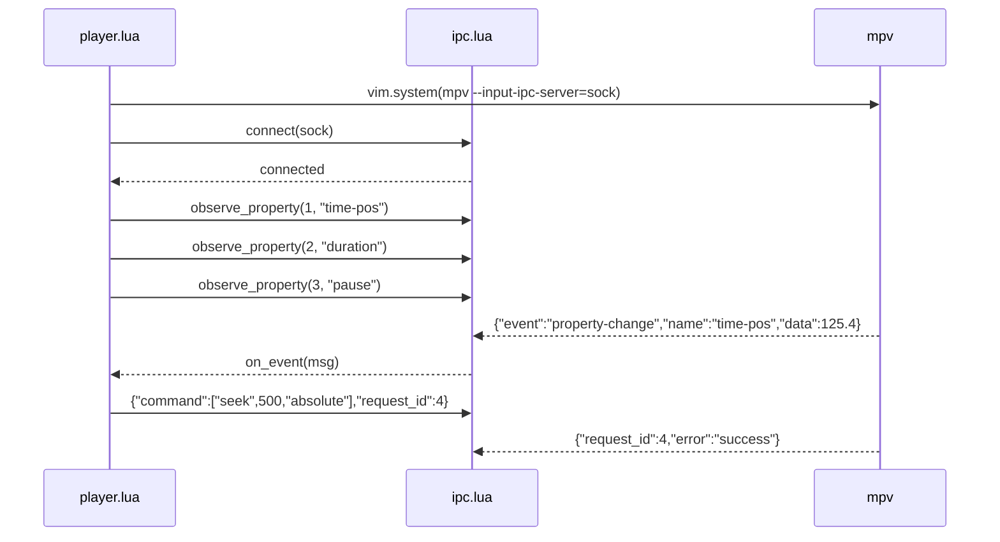

# Page 05: External Playback and Unix Socket IPC

## 5.1 Local-Only IPC Socket

FocusTube never opens TCP sockets or network listeners. For each playback session, `utils/paths.lua` generates a unique Unix domain socket path inside `$XDG_RUNTIME_DIR/focustube/` (or `<stdpath("state")>/focustube/`):

```
mpv-<pid>-<hrtime>.sock
```

`core/player.lua` spawns `mpv` with `vim.system` using an explicit argument vector including `--input-ipc-server=<socket_path>`, `--start=<resume_sec>`, and `--ytdl-raw-options=js-runtimes=deno`.

## 5.2 Connection Retry and Message Framing

Because `mpv` creates the socket asynchronously after spawning, `ipc.Client:connect` retries up to `ipc_connect_retries` (25) times at `ipc_retry_interval_ms` (100 ms) intervals using `vim.uv.new_pipe(false)` and `vim.uv.new_timer()`.



Incoming byte chunks are buffered and split on `\n`. Decoded JSON tables with a `request_id` invoke their registered callback; tables with an `event` field route to `on_event`.

## 5.3 Termination and Cleanup

When `mpv` exits or `player.stop()` is called, `player._cleanup()` stops the progress timer, closes the `uv_pipe_t` handle, and removes the temporary socket file via `vim.uv.fs_unlink`.

---
[Previous: Page 04](./04-sqlite-persistence-and-schema.md) | [Index](./README.md) | [Next: Page 06](./06-progress-and-crash-resilience.md)
