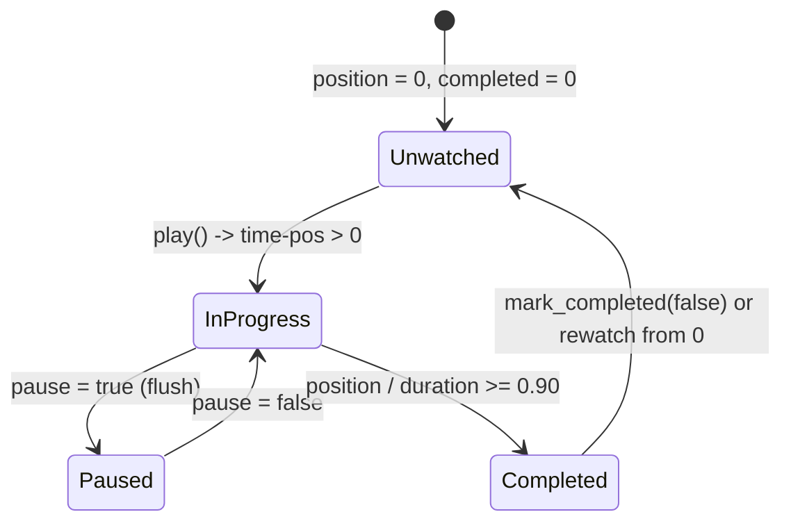

# Page 06: Progress Tracking and Crash Resilience

## 6.1 Multi-Trigger Flush Strategy

`core/progress.lua` ensures playback progress survives both clean exits and unexpected player or editor crashes by flushing `position_sec` and `duration_sec` on four independent triggers:

1. **Periodic Timer**: A `vim.uv.new_timer()` runs every `save_interval_ms` (default 5000 ms) and flushes whenever `dirty` is true.
2. **Pause Transition**: When `mpv` emits `property-change` for `pause = true`, `player.lua` calls `progress.flush()` immediately.
3. **Stream Termination**: `eof-reached`, `end-file`, IPC disconnect, and process exit all trigger `progress.flush()` or `progress.stop_tracking()`.
4. **Neovim Shutdown**: `init.lua` registers a `VimLeavePre` autocmd that stops active playback and flushes state before Neovim exits.

## 6.2 Completion Threshold and Resume Clamping

During each save with a positive `duration_sec`, `should_mark_completed` evaluates:

```
position_sec / duration_sec >= completion_threshold (default 0.90)
```

Once `completed` becomes `1`, subsequent updates preserve completion (`CASE WHEN completed = 1 THEN 1 ELSE ? END`). When reopening a video, `get_resume_position(video)` returns `0` if the video is completed or within `resume_margin_sec` (default 5 seconds) of the end; otherwise it returns `position_sec`.



---
[Previous: Page 05](./05-mpv-and-unix-socket-ipc.md) | [Index](./README.md) | [Next: Page 07](./07-timestamp-bookmarks.md)
