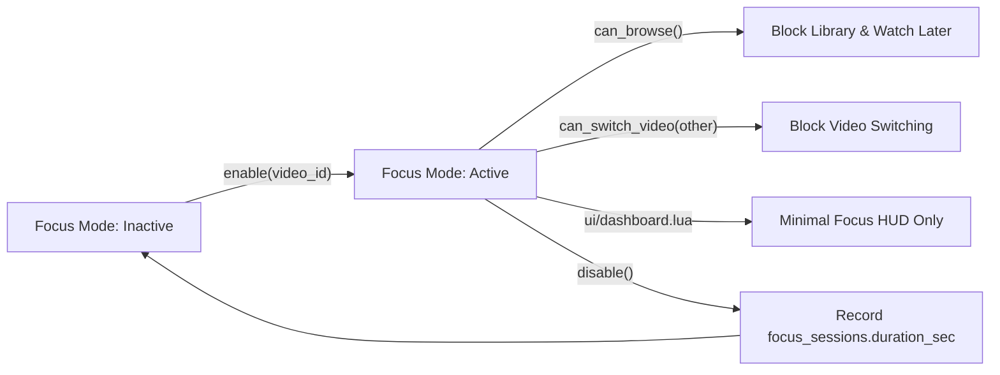

# Page 09: Focus Mode State Machine and Enforcement

## 9.1 Session Locking

`core/focus.lua` is the behavioral enforcement mechanism of FocusTube.nvim. Calling `focus.enable(video_id)` verifies that `video_id` is in the approved library, inserts a row into `focus_sessions`, sets `active = true`, and binds the session to `video_id`.

## 9.2 Behavioral Guards

While Focus Mode is active, two guards restrict navigation across the plugin:

1. **`focus.can_browse()`**: Returns `false` when `config.focus.block_browsing` is true. `ui/library.lua` and `ui/dashboard.lua` refuse to open library or Watch Later views and redirect the user to the locked Video Workspace.
2. **`focus.can_switch_video(target_id)`**: Returns `true` only when `target_id == locked_video_id`. `core/player.lua` checks this guard before spawning `mpv`, preventing playback of any other video until Focus Mode ends.

## 9.3 Minimal Focus HUD

In `ui/dashboard.lua`, active Focus Mode hides library totals, Watch Later counts, and URL-addition shortcuts, rendering only the locked video title, progress bar, elapsed session time, and direct playback, bookmark, and note controls.

---
[Previous: Page 08](./08-markdown-learning-notes.md) | [Index](./README.md) | [Next: Page 10](./10-testing-and-deployment.md)
